# DarGlobal AI Assistant

Production-oriented AI chatbot for the DarGlobal Junior AI Engineer – Applied AI technical assignment. The project scrapes publicly accessible information from DarGlobal and Wasalt, builds a retrieval-augmented knowledge base, serves grounded answers through FastAPI + OpenRouter, and provides a responsive React frontend with source citations.

> **Deployment/crawl status:** A live, fully integrated application (backend + frontend + RAG) is implemented and tested locally in this environment. Public deployment and fresh live scraping of DarGlobal are constrained here: Docker image build/publish requires external hosting access and sufficient image-build environment, and `https://darglobal.co.uk/` is currently protected by an Incapsula/anti-bot challenge for anonymous programmatic requests (see limitations). The repository includes a collected dataset snapshot and a reproducible pipeline.

## Features
- Public website scraping pipeline for DarGlobal and Wasalt (robots-aware access patterns, rate limiting, retries, URL normalization, deduping)
- Structured raw/processed data with source URLs, timestamps, and metadata
- Lightweight local retrieval (chunking + embeddings + numpy/FAISS-capable vector store abstraction)
- RAG chatbot with source citations and DarGlobal vs Wasalt distinction
- OpenRouter integration (configurable model, free-model auto-selection, timeout/error handling, fallback messages)
- FastAPI backend (`/health`, `/api/stats`, `/api/sources`, `/api/projects`, `/api/chat`, protected `/api/scrape`)
- Premium React + TypeScript + Vite + Tailwind frontend (source filter, suggested questions, citations, loading/error states, responsive layout, clear chat)
- Dockerized backend/frontend with `docker compose up --build`
- Automated tests for scraping/text utilities, chunking/retrieval, mocked OpenRouter integration, and API endpoints

## Technology Stack
- **Backend:** Python, FastAPI, Pydantic, Requests, BeautifulSoup, Tenacity, NumPy, SlowAPI
- **Retrieval:** Local hashed embeddings by default (optional fastembed/sentence-transformers), numpy vector search (FAISS support if available)
- **LLM:** OpenRouter Chat Completions API (free-model auto-selection supported)
- **Frontend:** React, TypeScript, Vite, Tailwind CSS, Nginx (production container)
- **Infra:** Docker, Docker Compose, Pytest

## Architecture

```mermaid
flowchart LR
    A[DarGlobal / Wasalt Public Pages] --> B[Scrapers\nrequests + BeautifulSoup]
    B --> C[Raw JSON + Metadata\nbackend/data/raw]
    C --> D[Cleaning & Normalization]
    D --> E[Chunking]
    E --> F[Embeddings\nlocal hashed / optional fastembed]
    F --> G[Vector Store\nnumpy .npy + metadata + manifest]
    G --> H[Retriever\nsemantic search + source filter]
    H --> I[FastAPI /api/chat]
    I --> J[OpenRouter LLM]
    J --> K[Grounded Answer + Citations]
    K --> L[React Chat UI]
```


## Project Structure
```text
darglobal-ai-assistant/
├── backend/
│   ├── app/
│   │   ├── api/            # FastAPI routes
│   │   ├── core/           # config/logging
│   │   ├── models/         # Pydantic schemas
│   │   ├── rag/            # chunking, embeddings, vector store, retrieval
│   │   ├── scraping/       # DarGlobal/Wasalt scrapers and orchestration
│   │   ├── services/       # OpenRouter and chat orchestration
│   │   └── utils/          # text utilities
│   ├── data/               # raw/processed/vectorstore/models (persisted snapshot)
│   ├── scripts/            # scrape/update/stats commands
│   ├── tests/              # pytest suite
│   ├── Dockerfile
│   └── requirements.txt
├── frontend/
│   ├── src/                # React UI
│   ├── Dockerfile
│   └── .env.example
├── docker/
│   └── nginx.conf          # frontend + API reverse proxy
├── docs/
├── docker-compose.yml
├── .env.example
└── README.md
```

## Data Collection Methodology
### DarGlobal (`https://darglobal.co.uk/`)
- Sitemap and in-site link discovery for project/about/content pages
- HTML parsing via BeautifulSoup with boilerplate stripping
- Metadata extraction (title, meta description, page path, contact hints, amenities/labels where present)
- Rate limiting, retries, URL normalization, deduplication, and timestamped raw JSON storage
- **Current live limitation (verified):** anonymous requests to `darglobal.co.uk` return an Incapsula challenge page (`/_Incapsula_Resource`), so fresh automated scraping cannot bypass protection. The scraper is designed to record blocked/challenge responses and stop responsibly.

### Wasalt (`https://wasalt.sa/`)
- English sitemap/static/category discovery (`cdn.wasalt.sa` sitemap assets) and curated seed URLs
- Focus on publicly accessible English informational/category/location/property pages
- Extraction of titles, descriptions, location/type hints, page content, and source metadata
- Robots-aware access patterns and bounded crawl scope

### Collected Dataset Snapshot (in repo)
- **DarGlobal:** 25 raw documents (`backend/data/raw/dar_global`)
- **Wasalt:** 24 raw documents (`backend/data/raw/wasalt`)
- **Knowledge base:** 49 unique documents, 279 chunks (DarGlobal 25 docs, Wasalt 24 docs)
- **Last scrape summary:** `backend/data/raw/last_scrape_summary.json`
- **KB stats:** `backend/data/processed/kb_stats.json`

> The snapshot enables end-to-end RAG/chat testing and Dockerized runs even when live site access is restricted.

## Scraping Limitations
- **DarGlobal anti-bot protection:** live pages currently respond with an access challenge; comprehensive fresh scraping is not possible without permitted, non-bypassing access in a compliant environment.
- **Bounded crawling:** scraper enforces per-site page limits, rate limiting, and scoped discovery to avoid unnecessary load.
- **Website changes:** structure/content and sitemap contents may change over time, affecting extraction quality.
- **No CAPTCHA/auth bypass:** scraper does not attempt to bypass anti-bot controls, logins, or protected content.

## RAG Implementation
1. Load raw JSON documents from `backend/data/raw`
2. Normalize/deduplicate by URL/content hash and preserve metadata (source, title, URL, scrape timestamp, page path, extracted fields)
3. Chunk text with overlap (`CHUNK_SIZE`, `CHUNK_OVERLAP`)
4. Generate embeddings (local hashed embeddings by default; optional fastembed/sentence-transformers backends)
5. Store vectors + metadata in `backend/data/vectorstore` (`embeddings.npy`, `metadata.json`, `manifest.json`, optional FAISS index)
6. Retrieve top-k chunks by semantic similarity with optional source filter (`dar_global` / `wasalt` / `all`)
7. Build grounded prompt for OpenRouter with retrieved context and source URLs
8. Return answer + structured source citations; degrade gracefully with retrieved excerpts when OpenRouter is unavailable

## OpenRouter Configuration
- API base: `OPENROUTER_BASE_URL` (default `https://openrouter.ai/api/v1`)
- API key: `OPENROUTER_API_KEY` (required for live LLM-generated answers)
- Model selection: `OPENROUTER_MODEL`
  - `auto` (default): queries OpenRouter model catalogue and selects an available `:free` text-capable model
  - or set an explicit free model ID from OpenRouter
- Fallback models: `OPENROUTER_FALLBACK_MODELS`
- Timeouts, retries, rate-limit/error handling, and degraded fallback responses are implemented

**Selected free-model setting in this environment:** `OPENROUTER_MODEL=auto` (runtime auto-selection). At verification time, OpenRouter exposed free text-capable models including `google/gemma-4-31b-it:free`, `inclusionai/ling-3.2-flash:free`, and `nvidia/nemotron-3.5-lightning:free` (availability can change).

## Local Installation
> This environment has constrained disk space; lightweight local installs were used (`.pydeps`) and frontend build artifacts are included.

### Prerequisites
- Python 3.11+ (tested with Python 3.14 here)
- Node.js 20+ and npm (for frontend dev/build)
- Docker + Docker Compose (for containerized run)

### Backend
```bash
python3 -m pip install --target ./.pydeps -r backend/requirements.txt
cp .env.example .env  # set OPENROUTER_API_KEY and other values as needed
PYTHONPATH=backend:./.pydeps uvicorn app.main:app --host 0.0.0.0 --port 8000 --app-dir backend
```

### Frontend
```bash
cd frontend
cp .env.example .env  # VITE_API_BASE_URL=http://localhost:8000 for local dev
npm install
npm run dev
```

## Docker Instructions
### Run complete app
```bash
cp .env.example .env
# configure OPENROUTER_API_KEY, CORS_ORIGINS, SCRAPE_ADMIN_TOKEN, etc.
docker compose up --build
```
- Frontend: `http://localhost:8080`
- Backend: `http://localhost:8000`
- Health: `http://localhost:8000/health`
- Swagger: `http://localhost:8000/docs`

### Notes
- `backend/data` is volume-mounted for dataset/vector-store persistence
- Frontend Nginx proxies `/api`, `/health`, `/docs`, `/openapi.json` to backend in compose
- For split hosting, set `VITE_API_BASE_URL` at frontend build time
- Backend image includes healthcheck; frontend depends on healthy backend

## Environment Variables
See `.env.example` (root) and `frontend/.env.example`.

| Variable | Purpose | Example/Default |
|---|---|---|
| `OPENROUTER_API_KEY` | OpenRouter API key (secret) | empty |
| `OPENROUTER_BASE_URL` | OpenRouter API base URL | `https://openrouter.ai/api/v1` |
| `OPENROUTER_MODEL` | Model ID or `auto` for free-model selection | `auto` |
| `OPENROUTER_FALLBACK_MODELS` | Comma-separated fallback model IDs | `openrouter/free,...` |
| `OPENROUTER_SITE_URL` | HTTP referer for OpenRouter requests | `http://localhost:5173` |
| `OPENROUTER_APP_NAME` | App title for OpenRouter requests | `DarGlobal AI Assistant` |
| `CORS_ORIGINS` | Allowed frontend origins (comma-separated) | `http://localhost:5173,...` |
| `SCRAPE_RATE_LIMIT_SECONDS` | Delay between scrape requests | `1.2` |
| `SCRAPE_MAX_PAGES_PER_SITE` | Max pages per site per run | `120` |
| `SCRAPE_ADMIN_TOKEN` | Token for protected `/api/scrape` | `change-me` / generated local token |
| `EMBEDDING_PROVIDER` | `auto`, `fastembed`, or `hash` | `auto` |
| `EMBEDDING_MODEL` | Embedding model name (fastembed path) | `BAAI/bge-small-en-v1.5` |
| `CHUNK_SIZE` / `CHUNK_OVERLAP` | Chunking params | `900` / `150` |
| `TOP_K_RESULTS` | Retrieval depth | `6` |
| `AUTO_BUILD_KB` | Build/load KB on startup | `true` |
| `VITE_API_BASE_URL` | Frontend API base URL (build-time) | empty for same-origin proxy, or backend URL |

## API Documentation
FastAPI auto-docs:
- Swagger UI: `/docs`
- OpenAPI JSON: `/openapi.json`

### Endpoints
- `GET /health` – service and knowledge-base health
- `GET /api/stats` – scraping + knowledge base + embedding/OpenRouter stats
- `GET /api/sources` – collected source documents/URLs (filterable)
- `GET /api/projects` – normalized project/listing-like items from collected metadata (filterable)
- `POST /api/chat` – grounded chat response with citations
  - Body: `{ "question": "...", "conversation_history": [{"role":"user","content":"..."}], "source_filter": "all|dar_global|wasalt", "top_k": 6 }`
- `POST /api/scrape` – protected scrape + rebuild endpoint (`X-Admin-Token` header required)

## Testing Instructions
### Backend tests
```bash
PYTHONPATH=backend:./.pydeps PYTEST_DISABLE_PLUGIN_AUTOLOAD=1 python3 -m pytest backend/tests -p pytest_asyncio.plugin -q
```
Covers:
- Text cleaning/chunking/extraction utilities
- Retrieval/vector store behavior and source filtering
- Chat service with mocked OpenRouter responses and degraded fallback behavior
- API endpoints (health/stats/sources/projects/chat validation/scrape auth)

### Frontend build verification
```bash
cd frontend
npm run build
```

### Runtime verification (local)
- Start backend and confirm `GET /health` returns `200`
- Query `/api/chat` and verify response includes `sources`/`source_urls` from collected dataset
- Load frontend and verify chat UI, filters, suggestions, citations, and clear-chat

## Deployment Instructions
### Recommended (Docker-capable platform)
1. Push repository to Git hosting (without `.env` / secrets)
2. Choose a free Docker-capable platform (Hugging Face Spaces Docker, Render, Railway trial, or other available option)
3. Configure environment variables/secrets:
   - `OPENROUTER_API_KEY`
   - `SCRAPE_ADMIN_TOKEN`
   - `CORS_ORIGINS` (public frontend origin)
   - `VITE_API_BASE_URL` (if frontend and backend are on different origins)
4. Deploy and verify:
   - `GET /health` returns 200
   - Frontend loads and calls backend successfully
   - `/api/chat` answers using retrieved dataset and returns citations
   - Mobile layout and source links work

### Current environment status
- **Docker CLI available:** `docker 29.1.3`, `docker compose v2.40.3`
- **Local Docker build/publish to public platform:** not completed in this session due to missing external hosting credentials/account access and environment constraints for full image publishing workflow
- **Public URL:** not obtained (cannot be claimed without successful deployment and live verification)

## Public Deployment URL
- **Pending** (requires external hosting account/credentials and OpenRouter API key configuration on the target platform)

## Backend Health-check URL
- **Pending deployment** (local verified endpoint: `http://localhost:8000/health`)

## Known Limitations
- DarGlobal live site is protected by anti-bot challenge for anonymous automated requests in this environment; fresh comprehensive scraping is not possible without compliant access.
- Dataset is a bounded snapshot (49 documents total) and may not represent all current projects/listings/prices.
- Free OpenRouter model availability/rate limits can change; verify and set a currently available free model before production use.
- Default embedding backend is lightweight (hashed) for portability; semantic quality improves with fastembed/sentence-transformers when installed.
- Public deployment URL is unavailable from this environment because hosting credentials/access were not provided.

## Security Notes
- API keys are read from environment variables only (`OPENROUTER_API_KEY`)
- `.env` is gitignored; `.env.example` provided
- Protected scraping endpoint requires `X-Admin-Token` (`SCRAPE_ADMIN_TOKEN`)
- Basic rate limiting, input validation, CORS configuration, and logging are enabled
