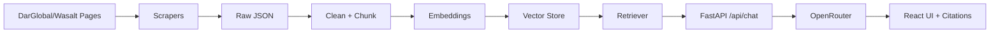

# DarGlobal AI Assistant

RAG chatbot using publicly available DarGlobal and Wasalt data, with FastAPI, OpenRouter, React, and Docker.

## Status
- App, tests, Docker configs, and knowledge base snapshot are included.
- Public app URL: pending (needs Hugging Face login/token and deployment).
- DarGlobal live scraping is limited by anti-bot protection for anonymous requests; scraper respects protections and does not bypass them.

## Architecture


## Dataset Snapshot
- DarGlobal: 25 documents
- Wasalt: 24 documents
- Knowledge base: 49 documents, 279 chunks
- Stats files: `backend/data/raw/last_scrape_summary.json`, `backend/data/processed/kb_stats.json`

## Stack
- Backend: Python, FastAPI, Requests, BeautifulSoup, NumPy
- Retrieval: chunking, embeddings, vector search, source filtering, citations
- LLM: OpenRouter (`OPENROUTER_MODEL=auto`, free model selection/fallbacks)
- Frontend: React, TypeScript, Vite, Tailwind
- Deploy: Docker (Hugging Face Spaces compatible), Docker Compose, Nginx

## Local Run
```bash
cp .env.example .env
python3 -m pip install --target ./.pydeps -r backend/requirements.txt
PYTHONPATH=backend:./.pydeps uvicorn app.main:app --app-dir backend --host 0.0.0.0 --port 8000
```

Frontend:
```bash
cd frontend
npm install
npm run dev
```

## Docker
```bash
cp .env.example .env
docker compose up --build
```
- Frontend: `http://localhost:8080`
- Backend: `http://localhost:8000`
- Health: `http://localhost:8000/health`
- Docs: `http://localhost:8000/docs`

## Scraping Commands
```bash
PYTHONPATH=backend:./.pydeps python3 backend/scripts/scrape.py --sites dar_global wasalt --max-pages 25
PYTHONPATH=backend:./.pydeps python3 backend/scripts/update_data.py --sites dar_global wasalt --max-pages 25
PYTHONPATH=backend:./.pydeps python3 backend/scripts/scrape_stats.py
```

## Environment Variables
See `.env.example` and `frontend/.env.example`.
- `OPENROUTER_API_KEY`: required for live LLM answers
- `OPENROUTER_MODEL`: `auto` or explicit free model
- `SCRAPE_ADMIN_TOKEN`: protects `POST /api/scrape`
- `CORS_ORIGINS`, `VITE_API_BASE_URL`
- `EMBEDDING_PROVIDER`, `CHUNK_SIZE`, `TOP_K_RESULTS`, `AUTO_BUILD_KB`

## API
- `GET /health`
- `GET /api/stats`
- `GET /api/sources`
- `GET /api/projects`
- `POST /api/chat`
- `POST /api/scrape` (`X-Admin-Token`)

## Testing
```bash
PYTHONPATH=backend:./.pydeps PYTEST_DISABLE_PLUGIN_AUTOLOAD=1 python3 -m pytest backend/tests -p pytest_asyncio.plugin -q
cd frontend && npm run build
```

## Deployment (Hugging Face Spaces)
- Create a Docker Space and push this repo.
- Set Space secret `OPENROUTER_API_KEY` for live OpenRouter answers.
- App runs on port `7860` via root `Dockerfile`.
- Verify: `/health`, `/docs`, and chat with source citations.

## Limitations
- DarGlobal anti-bot controls limit fresh automated scraping.
- Dataset is a bounded snapshot and may be incomplete.
- Free OpenRouter model availability and rate limits can change.
- Without `OPENROUTER_API_KEY`, responses fall back to retrieved excerpts with sources.
